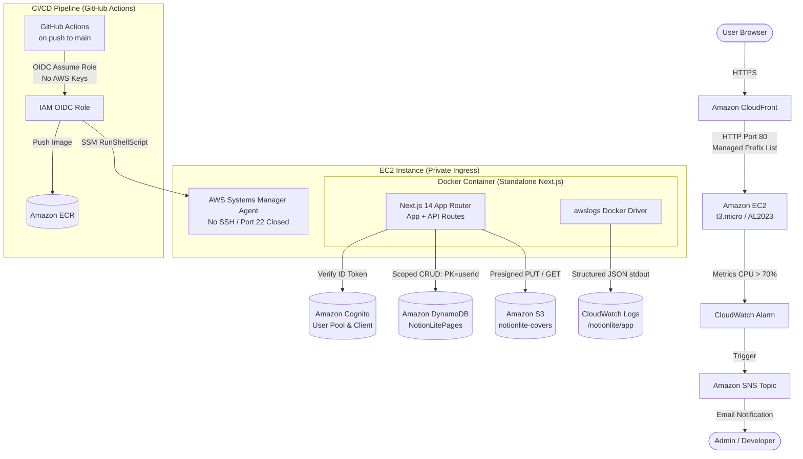

# NotionLite — Architecture

NotionLite is built with a 100% AWS backend architecture designed for security, zero keys in code, and lean operations.

---

## Component Breakdown

### 1. Edge Layer (Amazon CloudFront)
- **Role**: Termination of HTTPS and CDN edge routing.
- **Origin**: EC2 public DNS / IP over HTTP (port 80).
- **Behavior**: Caching disabled (`Cache-Control: no-store` / Managed-CachingDisabled policy) to support real-time state and authenticated routes.
- **Forwarding**: All HTTP request headers, query strings, and auth cookies (`nl_id_token`, `nl_access_token`, `nl_refresh_token`) are forwarded to the origin.

### 2. Compute Layer (Amazon EC2 + Docker)
- **Instance Type**: `t3.micro` running Amazon Linux 2023.
- **Security**:
  - Ingress: Port 80 allowed **only** from the CloudFront Managed Prefix List (`pl-58a44031` or region-equivalent).
  - Port 22 (SSH) is completely **closed**.
  - All deployments and administrative tasks run through **AWS Systems Manager (SSM)**.
- **Runtime**: Multi-stage Docker container running Next.js in `standalone` mode on port 3000, mapped to host port 80.
- **Logging**: Docker `awslogs` log driver streams structured stdout JSON entries directly to CloudWatch log group `/notionlite/app`.

### 3. Authentication (Amazon Cognito)
- **Flow**: Custom UI forms (no hosted UI) using direct SDK calls to `SignUp`, `ConfirmSignUp`, and `InitiateAuth`.
- **Session**: Cognito tokens are stored in `httpOnly`, `Secure`, `SameSite=Lax` cookies.
- **Verification**: API routes verify incoming ID tokens using `aws-jwt-verify` and extract the `sub` claim as the immutable `userId`.

### 4. Database (Amazon DynamoDB)
- **Table**: `NotionLitePages` (Pay-per-request / On-demand billing).
- **Primary Key**:
  - Partition Key (`PK`): `userId` (String)
  - Sort Key (`SK`): `pageId` (String, ULID format)
- **Security**: Every query and mutation is strictly partition-scoped to the authenticated `userId`.

### 5. Media Storage (Amazon S3)
- **Bucket**: Private bucket `notionlite-covers-<account>-<suffix>`.
- **Access Pattern**: Presigned PUT URLs (5-minute expiry, max 2MB, image MIME types only) and presigned GET URLs (1-hour expiry).
- **Key Validation**: Keys are strictly validated to begin with `${userId}/` to prevent unauthorized cross-tenant object access.

### 6. Observability & Alerting (Amazon CloudWatch + SNS)
- **Logs**: JSON stdout logged to `/notionlite/app` with 14-day retention.
- **Alarms**: Metric alarm triggers when instance `CPUUtilization` exceeds 70% for two consecutive 5-minute periods, publishing an alert to an SNS topic that emails subscribers.
